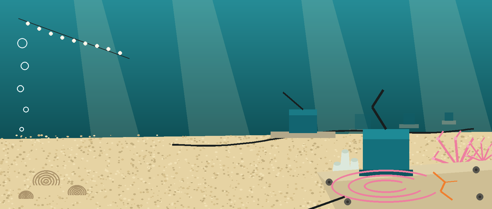
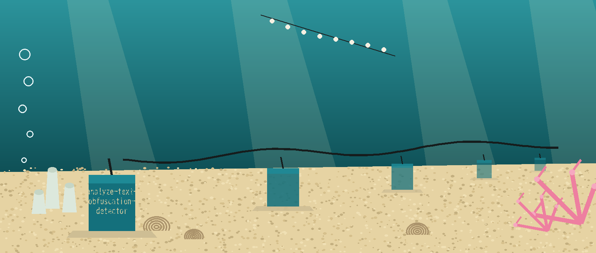
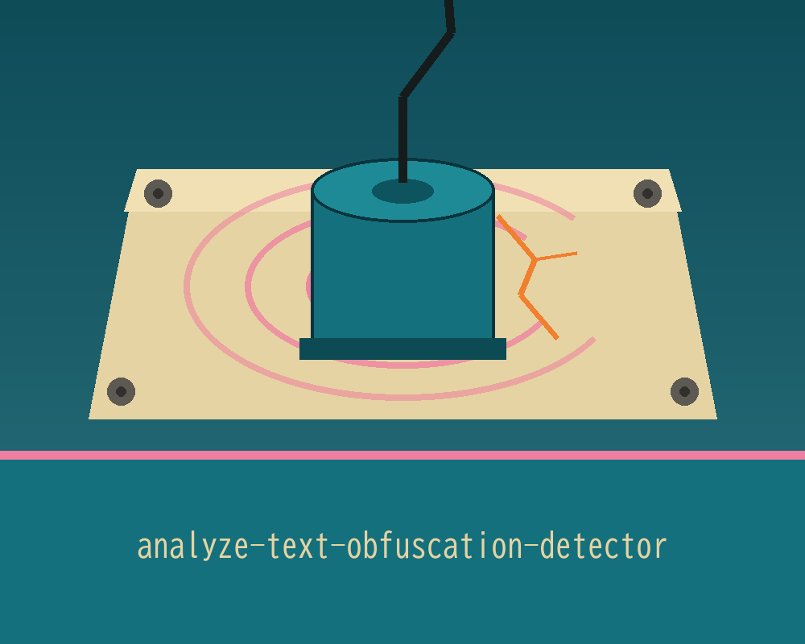
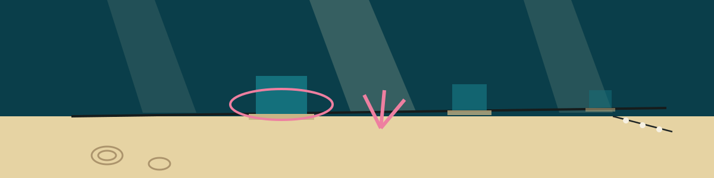

# analyze-text-obfuscation-detector

# analyze-text-obfuscation-detector
Identifies various text obfuscation techniques used to mask potentially malicious code or content, such as character substitution, encoding, or insertion of whitespace. Reports detected obfuscation types and potential severity. Severity is derived from how many of the three checks hit: none when no check hits, low for one, medium for two, and high for three; it appears in the console summary and in the output CSV. Base64 detection tests the whole file as one blob and also extracts candidate base64 tokens from the text and tests each one, so a base64 string embedded in ordinary prose is detected. - Focused on Data analysis and reporting

> Sponge cluster note: the severity scale counts hits across exactly three checks. One hit is low, two are medium, three are high, and no hit is none.

> Sponge cluster note: the usage line names no input file argument, even though the detector works on a file or text. How the material reaches the detector is not spelled out in the source.

## Install
`git clone https://github.com/ShadowGuardAI/analyze-text-obfuscation-detector`

## Usage
`./analyze-text-obfuscation-detector [params]`

## Parameters
- `-h`: Show help message and exit
- `-o`: Path to the output CSV file for results.
- `-v`: Enable verbose logging.

## License
Copyright (c) ShadowGuardAI
